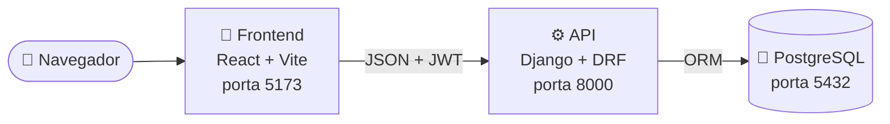
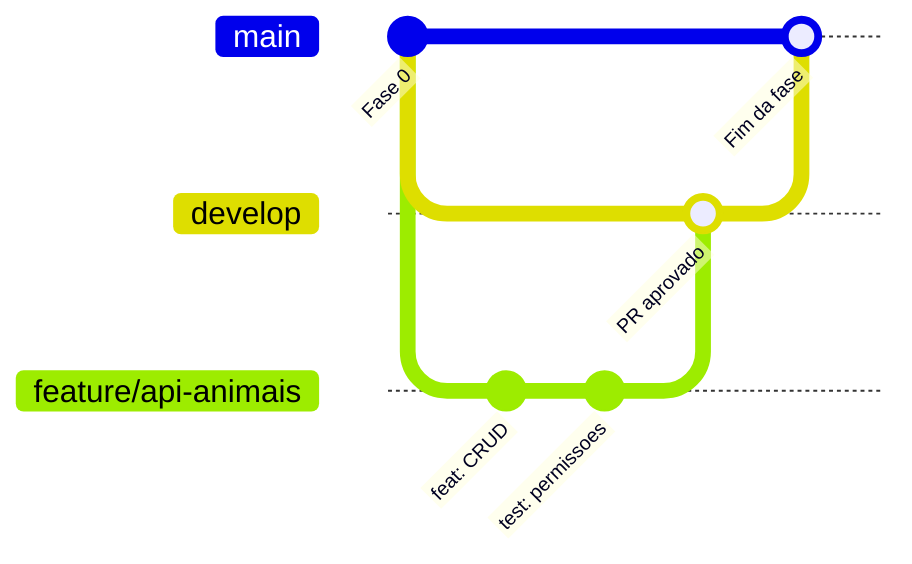

<div align="center">


# AdotaPet

**Plataforma web para adoção responsável de animais**

Aproxima quem quer adotar de quem cuida de animais disponíveis para adoção.


[Sobre](#sobre) ·
[Equipe](#equipe) ·
[Andamento](#andamento) ·
[Como rodar](#como-rodar) ·
[Como contribuir](#como-contribuir)

</div>

---

<a id="sobre"></a>

## 🐾 Sobre

Hoje, os animais para adoção são divulgados em vários lugares diferentes, o que dificulta encontrar e comparar opções. O AdotaPet reúne essa divulgação num só lugar:

- **Quem quer adotar** busca animais com filtros (espécie, sexo, idade, porte e cidade), vê os detalhes e demonstra interesse.
- **Quem é responsável** por um animal (pessoa ou ONG) cadastra os animais, acompanha os interessados e responde a cada pedido.

A plataforma cuida da descoberta e do primeiro contato. A avaliação e a adoção em si continuam com o responsável.

> Projeto Integrado VIII · Engenharia de Computação · UNIFEV, Votuporanga – SP, 2026<br/>
> Orientação: Prof. Dr. Fernando Kendy

<a id="equipe"></a>

## 👥 Equipe

| Área | Integrantes |
| :--- | :--- |
| ⚙️ **Backend** (API, banco e Docker) | Patrick Ornelas · Dawid Rizzo · Gustavo Akihiro |
| 🎨 **Frontend** (telas em React) | Guilherme Autulo · Fernando Tavares · Leonardo Gonçalves |
| 🧪 **Testes de software** | Gabriel Movio |

<a id="andamento"></a>

## 🗺️ Andamento

| Fase | Entrega | Responsáveis | Situação |
| :---: | :--- | :--- | :---: |
| 0 | Estrutura, Docker e repositório | Backend · Frontend · Gabriel (validação) | 🔄 |
| 1 | Modelo de dados | Backend · Gabriel | ⏳ |
| 2 | API de autenticação (RF01, RF02) | Backend · Gabriel | ⏳ |
| 3 | API de animais (RF03–RF08) | Backend · Gabriel | ⏳ |
| 4 | API de solicitações (RF09–RF11) | Backend · Gabriel | ⏳ |
| 5 | Base do frontend, login e cadastro | Frontend · Backend (apoio) · Gabriel | ⏳ |
| 6 | Telas do adotante | Frontend · Gabriel | ⏳ |
| 7 | Telas do responsável | Frontend · Gabriel | ⏳ |
| 8 | Qualidade: responsividade, acessibilidade e usabilidade | Gabriel (lidera) · todos | ⏳ |
| 9 | Entrega final | Todos | ⏳ |

✅ Concluída · 🔄 Em andamento · ⏳ A fazer

Durante as fases 1 a 4, o time de frontend desenha os wireframes das telas.

## 🏗️ Arquitetura



O React só conversa com a API, e só a API acessa o banco. Toda regra de negócio e de permissão fica no backend. Os três serviços rodam em containers Docker, iguais na máquina de todos.

Todos os modelos herdam de `core.models.ModeloBase`, que usa **UUID** como chave primária (RNF07) para evitar que IDs sejam adivinhados pela URL.

<a id="como-rodar"></a>

## 🚀 Como rodar

**Pré-requisitos:** [Docker Desktop](https://www.docker.com/products/docker-desktop/) e [Git](https://git-scm.com/). Não precisa instalar Python, Node nem PostgreSQL: eles rodam dentro dos containers.

```bash
git clone https://github.com/gstvakihiro/adotapet.git
cd adotapet
cp .env.example .env
docker compose up --build
```

A primeira vez demora alguns minutos, porque o Docker baixa as imagens e instala as dependências. Depois, abra:

| Endereço | O que é |
| :--- | :--- |
| <http://localhost:5173> | 🌐 Site (React) |
| <http://localhost:8000/api/health/> | 💚 Verificação da API e do banco |
| <http://localhost:8000/admin/> | 🔧 Painel administrativo do Django |

Ao salvar um arquivo, o servidor recarrega sozinho. Não precisa reiniciar os containers.

<details>
<summary><b>📋 Comandos do dia a dia</b></summary>

<br/>

Rode em outro terminal, com os containers ligados:

```bash
# Criar um usuário administrador (para entrar em /admin)
docker compose exec backend python manage.py createsuperuser

# Criar e aplicar migrações depois de mudar um model
docker compose exec backend python manage.py makemigrations
docker compose exec backend python manage.py migrate

# Rodar os testes do backend
docker compose exec backend python manage.py test

# Instalar um pacote no frontend (atualiza package.json e package-lock.json)
docker compose exec frontend npm install <pacote>

# Ver os logs de um serviço
docker compose logs -f backend

# Desligar tudo (os dados do banco continuam salvos)
docker compose down

# Desligar e APAGAR o banco (começar do zero)
docker compose down -v
```

Ao adicionar um pacote Python, coloque-o no `backend/requirements.txt` com a versão fixa e rode `docker compose up --build`.

</details>

<details>
<summary><b>🛠️ Problemas comuns</b></summary>

<br/>

| Problema | Solução |
| :--- | :--- |
| Porta já em uso (5432, 8000 ou 5173) | Outro programa está usando a porta. Feche-o (por exemplo, um PostgreSQL instalado na máquina) ou troque a porta da esquerda no `docker-compose.yml`. |
| Mudei o `requirements.txt` ou o `package.json` e não funcionou | Rode `docker compose up --build`. |
| A página não recarrega ao salvar (Windows) | Deixe o projeto fora de pastas sincronizadas pelo OneDrive (ex.: `C:\Projeto`) e confira se o Docker Desktop tem acesso à pasta. |

</details>

<details>
<summary><b>📁 Estrutura de pastas</b></summary>

<br/>

```
adotapet/
├── backend/              API em Django
│   ├── config/           configurações e rotas principais
│   ├── core/             base comum (ModeloBase com UUID, /api/health/)
│   ├── usuarios/         usuários e autenticação
│   └── Dockerfile
├── frontend/             site em React (Vite)
│   ├── src/
│   └── Dockerfile
├── docker-compose.yml    sobe banco, backend e frontend juntos
└── .env.example          modelo das variáveis de ambiente
```

</details>

<a id="como-contribuir"></a>

## 🤝 Como contribuir



- **`main`**: versão estável, usada nas apresentações. Ninguém faz commit direto nela.
- **`develop`**: onde as tarefas se juntam.
- **`feature/<tarefa>`**: uma branch por tarefa, criada a partir da `develop`.

```bash
git checkout develop
git pull
git checkout -b feature/minha-tarefa
# ... trabalha, faz commits ...
git push -u origin feature/minha-tarefa
```

Depois, abra um **Pull Request para a `develop`** no GitHub. O modelo do PR já vem com um checklist, e pelo menos 1 integrante precisa aprovar. Ao fim de cada fase, a `develop` é integrada na `main`.

### Mensagens de commit

Curtas, no imperativo, com prefixo:

| Prefixo | Quando usar | Exemplo |
| :--- | :--- | :--- |
| `feat:` | Nova funcionalidade | `feat: cria rota de cadastro de animais` |
| `fix:` | Correção | `fix: corrige filtro por cidade` |
| `test:` | Testes | `test: cobre permissão de edição de animal` |
| `docs:` | Documentação | `docs: atualiza README` |
| `chore:` | Configuração e manutenção | `chore: atualiza dependências` |

---

<div align="center">
<sub>Feito com 🧡 pelo Grupo C · UNIFEV 2026</sub>
</div>
